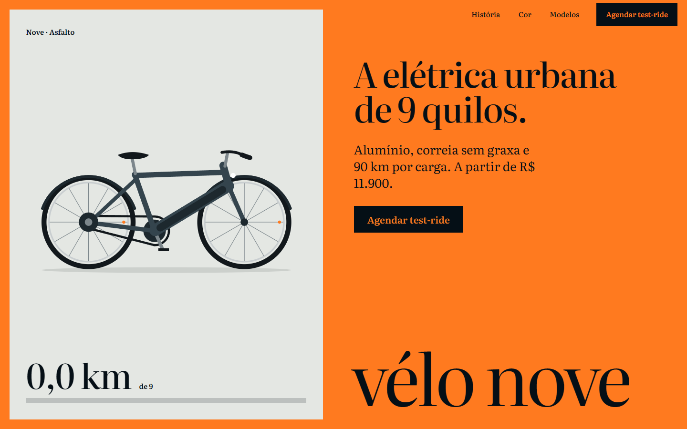

# Vélo Nove

Landing page de uma bicicleta elétrica urbana de 9 quilos, contada pelo scroll: a bike fica fixa de um lado, a página corre do outro, e o trajeto de 9 km vira um odômetro.



> **Projeto de portfólio, marca fictícia.** Vélo Nove não existe: nome, produto, preços, pontos de test-ride e e-mail são inventados. Nenhuma marca, logo ou site real foi imitado.

## Ideia

O nome carrega o conceito. *Nove* é o peso (9,4 kg) e é o trajeto (9 km de ida, 9 de volta, cinco dias úteis = os 90 km de uma carga). A tela da esquerda nunca sai do lugar: mostra a bicicleta, um odômetro de 0 a 9 km que anda com o scroll e o destaque da peça de que o capítulo fala. A coluna da direita traz o texto.

## O que tem

- **História pinada**: quatro capítulos (quadro, motor, bateria, correia). A cada um, a peça acende na bike, a etiqueta aparece e o número principal conta até o valor.
- **Configurador de cor**: quatro cores, e a bike pinada troca com transição (sai, troca, volta por uma mola interrompível) enquanto o campo atrás muda de tom. Funciona com mouse, toque e setas do teclado.
- **Comparativo de modelos**: tabela real com três modelos e um controle de km por dia que recalcula "a cada quantos dias recarregar".
- **CTA de test-ride**: formulário sem backend que abre o e-mail do visitante com o pedido pronto (modelo e cor escolhidos entram junto).

## Destaques de design e animação

- Direção *split stage* (tasteskill): metade fixa, metade de leitura, e a página quebra o split nas seções largas (comparativo e test-ride).
- Tipografia única: Literata (variável, eixo óptico), tracking negativo nos títulos grandes, 15 px como menor tamanho.
- Cores: laranja de sinalização + preto-azulado + branco; cada cor da bike traz o próprio campo.
- A bike é **desenhada em SVG inline** e recolorida por variáveis CSS (nenhuma foto de produto falsa).
- Movimento: rodas giram com o scroll, odômetro e barra de trajeto lineares ao scroll, wordmark que encolhe 7% ao sair da primeira tela, entradas escalonadas (60–80 ms), contagem dos números, foto final com leve zoom.
- Feedback no toque: `:active` escala o botão na hora do press, não na soltura. Molas próprias (`src/spring.ts`) herdam posição e velocidade ao serem reapontadas, então trocar de cor no meio da transição não dá tranco.
- `prefers-reduced-motion`: sem deslocamento, sem rotação de roda, sem contagem; o conteúdo continua inteiro.
- Celular: o pin não cabe (cobriria o texto), então cada capítulo ganha a própria bike.

Medições locais (build de produção, desktop): Lighthouse 99 / 100 / 100 (desempenho, acessibilidade, boas práticas); LCP 1,7 s, CLS 0, TBT 40 ms.

## Componentes React Bits

Copiados de [reactbits.dev](https://reactbits.dev) (variantes TS) para `src/react-bits/`, com a dependência `motion`. Todos respeitam `prefers-reduced-motion` (sem movimento, conteúdo legível).

| Componente | Onde |
| --- | --- |
| `BlurText` | Títulos h2 de cada capítulo, ficha técnica, configurador, comparativo e test-ride (palavra a palavra, ao entrar na tela) |
| `CountUp` (modo *roll*) | Números grandes dos capítulos e da ficha técnica: dígitos rolam como um odômetro |
| `Magnet` | Botões "Agendar test-ride" (hero e configurador) puxam levemente em direção ao cursor |
| `ClickSpark` | Página inteira: faíscas laranja a cada clique |
| `ShinyText` | Wordmark "vélo nove" no hero: brilho que atravessa a palavra |
| `TiltedCard` | Fotos dos capítulos: inclinação 3D, brilho e sombra seguindo o ponteiro |

Edições locais: `BlurText` usa `<span>` na raiz (para viver dentro do `<h2>`), `CountUp` usa vírgula decimal (pt-BR) e `TiltedCard` carrega a imagem com `loading="lazy"`.

## Stack

React 19 · TypeScript · Vite · CSS puro (tokens em variáveis) · `@fontsource-variable/literata` · `motion` (exigido pelos componentes React Bits). As molas próprias e o scroll continuam em código local.

## Como rodar

```bash
npm install
npm run dev        # desenvolvimento
npm run build      # tsc + vite build em dist/
npm run preview    # serve o build
```

## Deploy (GitHub Pages)

`vite.config.ts` usa `base: './'` e as imagens são referenciadas sem barra inicial, então o build funciona em qualquer subcaminho. O workflow `.github/workflows/pages.yml` publica `dist/` com `actions/deploy-pages` a cada push na `main`. Em *Settings → Pages*, escolha **GitHub Actions** como fonte.

## Créditos das fotos

Todas com licença livre, baixadas e comprimidas; os créditos também estão no rodapé da página.

| Foto | Autor | Licença | Fonte |
| --- | --- | --- | --- |
| "Evening Cyclist" (test-ride) | Nick Page Photos | CC BY 2.0 | [Flickr](https://www.flickr.com/photos/27506472@N04/8106152459) |
| "Rama VIII Bridge & the Chao Phraya River, Bangkok Bicycle Tour" (bateria) | David McKelvey | CC BY 2.0 | [Wikimedia Commons](https://commons.wikimedia.org/w/index.php?curid=112989780) |
| "Bike rail, public stairs" (quadro) | La Citta Vita | CC BY-SA 2.0 | [Flickr](https://www.flickr.com/photos/49539505@N04/4764105631) |
| "Yellow Lines" (motor) | Tim Sullivan | CC0 | [StockSnap](https://stocksnap.io/photo/yellow-lines-OJYARI0WOY) |
| "Cyclist Super Highway" (correia) | Kurayba | CC BY-SA 2.0 | [Flickr](https://www.flickr.com/photos/48503330@N08/52141470529) |

As fotos mostram o mundo da bicicleta, nunca o produto: a Vélo Nove só existe como desenho em código.

## Observações

- O e-mail `testride@velonove.example` é um endereço de exemplo; troque antes de qualquer uso real.
- Especificações, preços e a referência ao limite legal de 32 km/h são conteúdo de exemplo.
- `docs/preview.png` é gerado por `node scripts/preview.mjs` com Chrome headless via CDP, em tempo real (precisa de `npx vite preview --port 4791` rodando).

## Licença

Código sob MIT. As fotos mantêm as licenças de origem listadas acima.
